

# Learning Journey

**Set a learning goal, show up every day, and keep your streak alive.**

**Challenge 2: Hello World**
*Bring the provided UI design to life.*

---

## App Name & Purpose

**Learning Journey** is an iOS app that helps you build a daily learning habit. Pick what you want to learn and for how long, log your progress each day, and use freezes to protect your streak when life gets busy.

---

## Main Features

- **Set a learning goal**: choose a topic and a duration (Week, Month, or Year).
- **Log as Learned**: mark each day as learned with one tap and grow your streak.
- **Freeze a day**: skip a day without losing your streak, within a limit set by the duration.
- **Streak and freeze counters**: see your learned and frozen days at a glance.
- **Weekly strip**: today's status and the current week on the main screen.
- **Calendar view**: browse month by month and tap any day to see its goal, duration, and status.
- **Update your goal**: changing only the duration keeps your streak, while a new topic starts fresh.
- **Goal completion**: celebrate finishing your goal, or set a new one if you did not reach it.
- **Saved on your device**: your goal, your days, and your goal history are still there when you reopen the app.

---

## How It Works

**Freezes per duration**

| Duration | Freezes |
|:---:|:---:|
| Week | 2 |
| Month | 8 |
| Year | 96 |

**Your streak resets when:**
- More than 32 hours pass without logging a day as learned or using a freeze.
- The learning goal is updated to a new topic.

**Buttons are disabled when:**
- All freezes are used.

You can switch between Learned and Freeze during the same day. When the chosen duration ends, the app shows the result: completed if every day of the goal was logged as learned or freezed, otherwise not reached.

---

## App Walkthrough

| Onboarding |  Activity | Logged as Learned | Calendar |
|:---:|:---:|:---:|:---:|
| 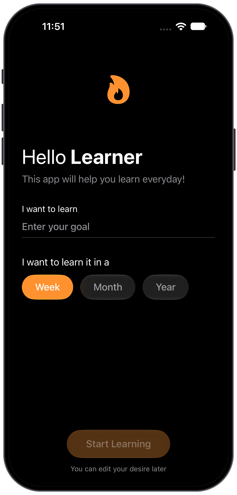 |  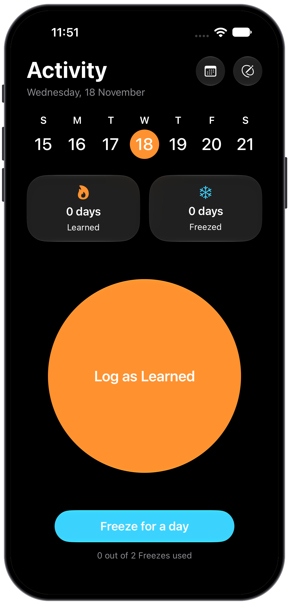 | 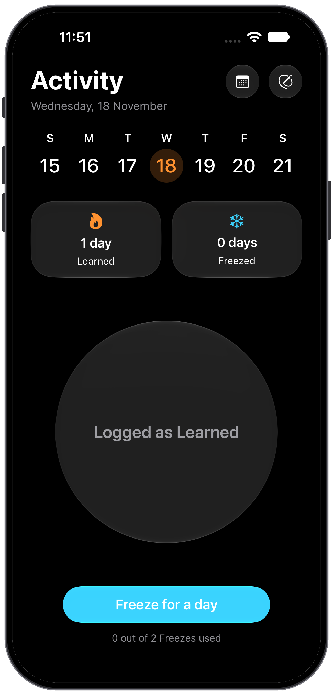 | 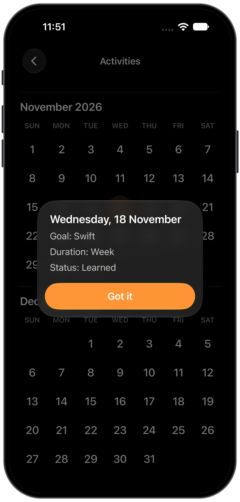 |

| Update goal | New goal | Goal completed | Goal not reached |
|:---:|:---:|:---:|:---:|
| 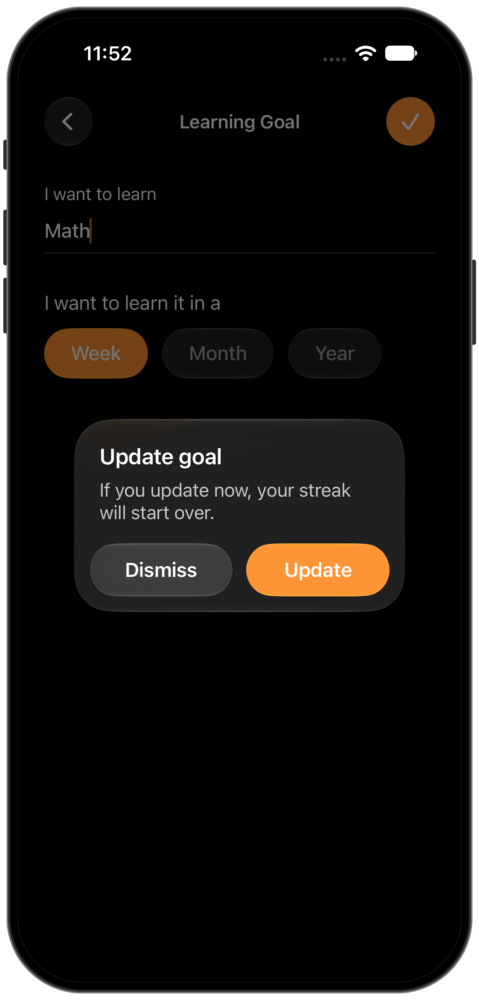 | 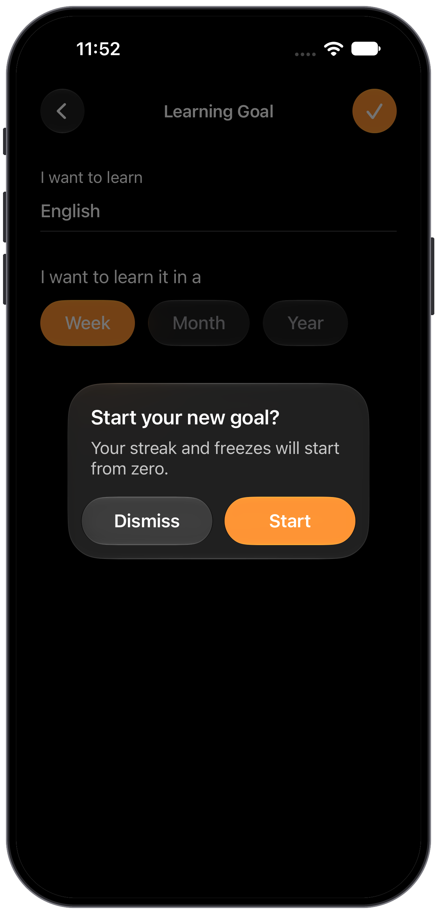 | 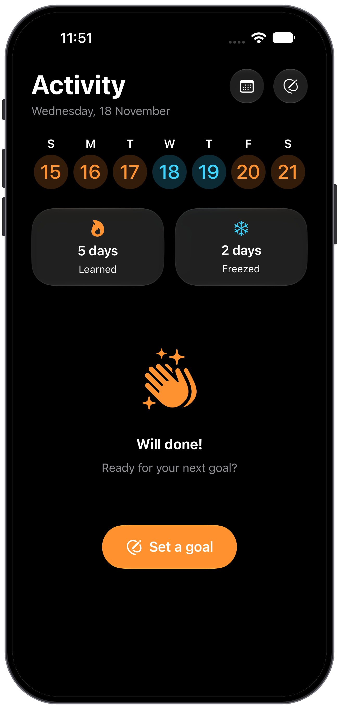 | 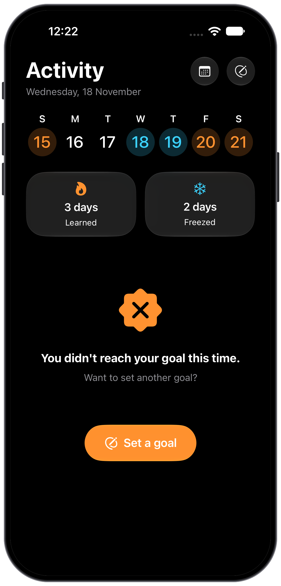 |

---

## App Icon

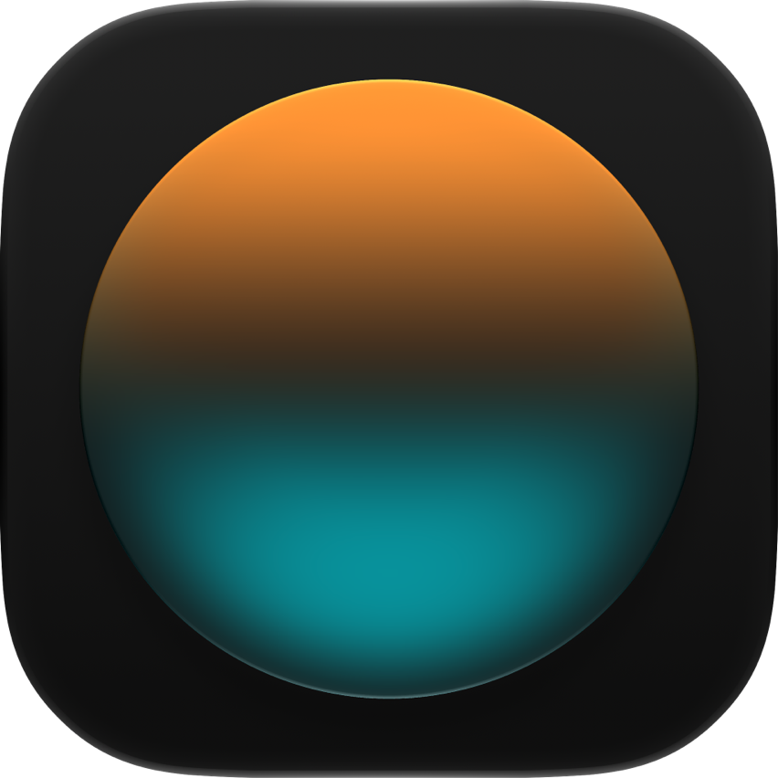

This is the Learning Journey app icon: a glass sphere that blends the app's two accent colors, orange for the learning streak and blue for freezes.

---

## Technologies Used

- **Swift** and **SwiftUI**
- **MVVM** architecture (Model / Service / View / ViewModel)
- **Liquid Glass** dark UI with orange and blue accents
- Xcode

---

## Debug Mode

The project includes a **debug-only** tool ("Debug: set the week") that lets you mark days as learned or frozen. It is **only a means to demonstrate that the code works**, so every screen and state can be reviewed without waiting several days. It is not part of the app's core logic.

**How to open it:** run a Debug build, go to the Activity page, and long-press the "Activity" header. The panel also has buttons to move the app's clock forward (+1 day and +33 hours).

| Debug: set the week | Streak and freezes (Month goal) | 
|:---:|:---:|
| 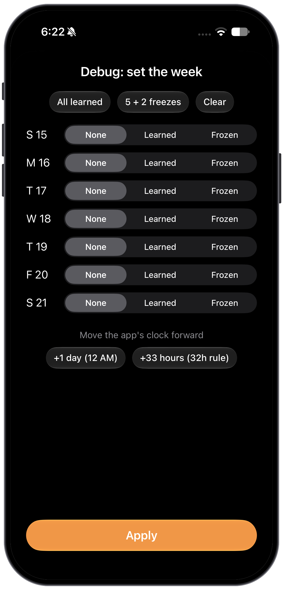 | 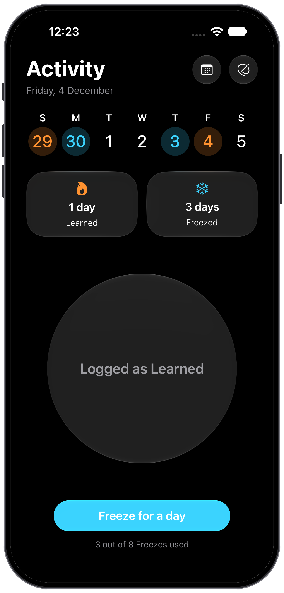 |

**Time-based rules**

Some rules depend on real time, so they cannot be seen during a short review. Debug mode is used to show their results without waiting:

- **32 hours:** the streak resets when more than 32 hours pass without logging a day as learned or using a freeze.
- **12 AM:** Log as Learned and Freeze are enabled again at 12 AM, even if the user logged a learning day at 11 PM.
